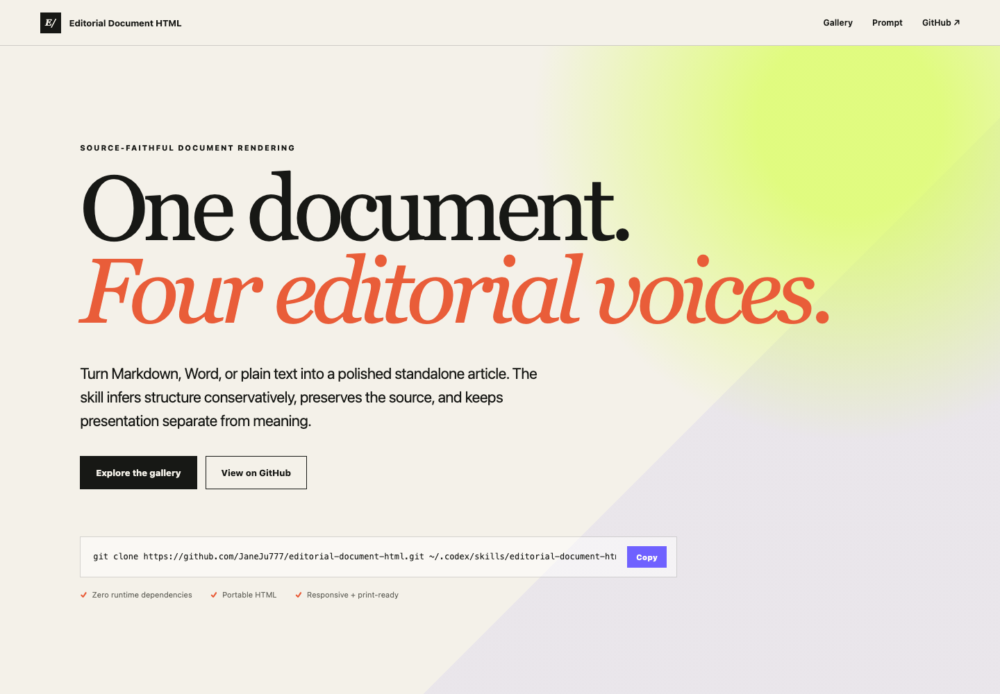

# Editorial Document HTML

Turn Markdown, Word, or plain text into a source-faithful standalone HTML article — without asking authors to label UI components by hand.

[View the live gallery](https://janeju777.github.io/editorial-document-html/) · [Read the skill instructions](SKILL.md) · [See the schema](references/article-schema.md)



## Why this exists

Most document-to-web tools either flatten structure or rewrite the source to fit a template. This skill takes a different approach:

- Preserves wording, links, media, tables, ordering, and provenance.
- Infers headings, lists, comparisons, key-value information, notes, quotes, and processes conservatively.
- Separates semantic structure from presentation, so one document can use four distinct styles.
- Produces portable HTML with local open-source fonts, responsive layouts, print styles, dark mode, text sizing, and keyboard-friendly tables.

## Install

```bash
git clone https://github.com/JaneJu777/editorial-document-html.git ~/.codex/skills/editorial-document-html
```

If you already cloned the repository elsewhere, copy or symlink it into `~/.codex/skills/editorial-document-html`.

## Use it

Ask Codex:

```text
Use $editorial-document-html to turn this Markdown document into a source-faithful standalone HTML article. Infer its semantic structure, preserve every claim and link, use humanist-blog style, and verify desktop, mobile, dark mode, and print behavior. Do not rewrite or summarize the source.
```

Or run the scripts directly:

```bash
python3 scripts/infer_article.py source.md article.json --style humanist-blog
python3 scripts/validate_article.py article.json
python3 scripts/render_article.py article.json article.html
```

The inference script accepts `.md`, `.markdown`, `.txt`, and `.docx`. The renderer uses Python's standard library; no application dependency install is required.

## Four presentation systems

| Style | Best for | Preview |
| --- | --- | --- |
| `editorial` | Product strategy, proposals, decision records | [Open example](https://janeju777.github.io/editorial-document-html/previews/editorial-preview.html) |
| `newsroom` | Reports, essays, research, publication-like reading | [Open example](https://janeju777.github.io/editorial-document-html/previews/newsroom-preview.html) |
| `humanist-blog` | Playbooks, technical explainers, long-form guides | [Open example](https://janeju777.github.io/editorial-document-html/previews/humanist-blog-preview.html) |
| `notebook` | Teaching notes, walkthroughs, reflective documents | [Open example](https://janeju777.github.io/editorial-document-html/previews/notebook-preview.html) |

The former `claude-blog` identifier remains accepted as a deprecated input-only alias for backward compatibility. New files, examples, and public copy should use `humanist-blog`; rendered output is always normalized to that name.

## How it works

```text
Markdown / DOCX / text
        ↓
conservative structure inference
        ↓
reviewable semantic article JSON
        ↓
one of four presentation systems
        ↓
portable standalone HTML
```

Ambiguous material remains ordinary prose or a list. The skill does not invent authors, dates, translations, claims, quotations, images, or missing sections.

## Development

```bash
python3 scripts/check_skill.py
python3 scripts/build_previews.py
python3 scripts/build_gallery.py
```

See [CONTRIBUTING.md](CONTRIBUTING.md) for contribution guidance, [assets/fonts/FONT-SOURCES.md](assets/fonts/FONT-SOURCES.md) for packaged font provenance and checksums, and [THIRD_PARTY_NOTICES.md](THIRD_PARTY_NOTICES.md) for third-party licensing.

## Independence and trademarks

Editorial Document HTML is an independent open-source project. It is not affiliated with, endorsed by, or sponsored by Anthropic, OpenAI, Monocle, or any other third-party publication or technology company. All trademarks belong to their respective owners. The project does not distribute third-party logos, proprietary site chrome, or branded promotional assets.

## License

Code and project documentation are available under the [MIT License](LICENSE). Bundled fonts and the small Gallery recording utility remain under their respective licenses; see [third-party notices](THIRD_PARTY_NOTICES.md).
